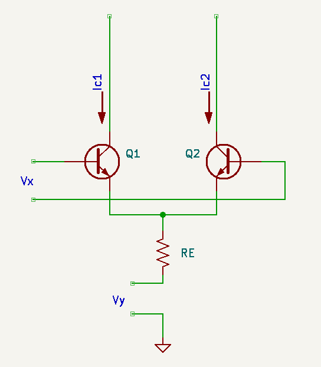
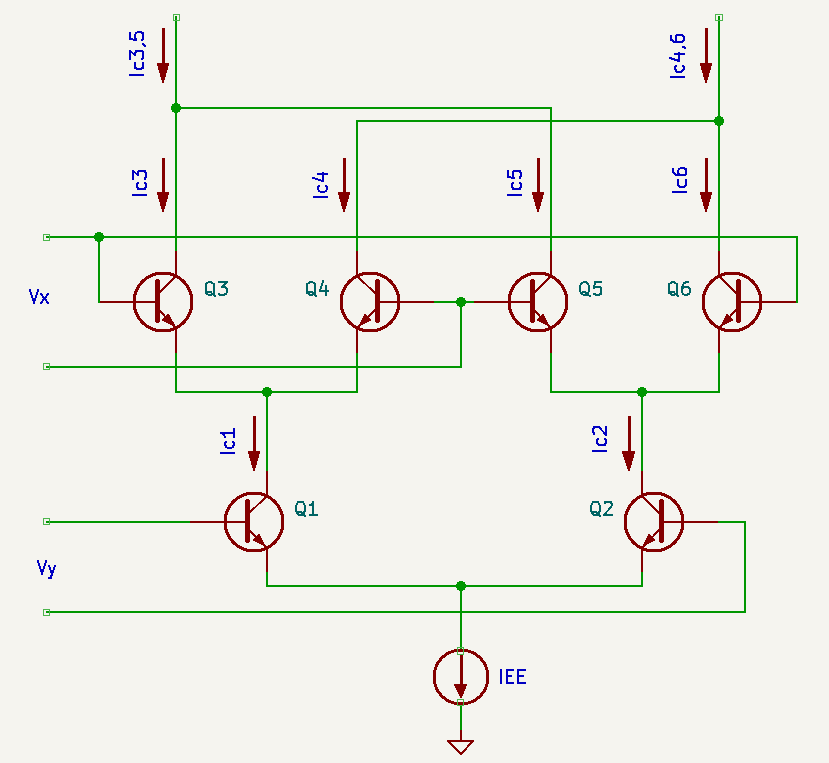
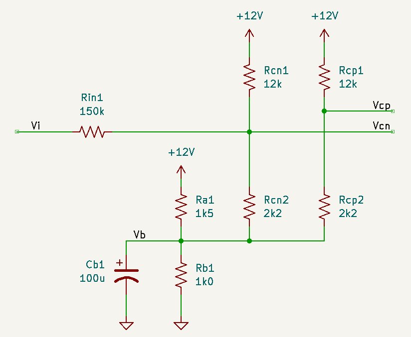
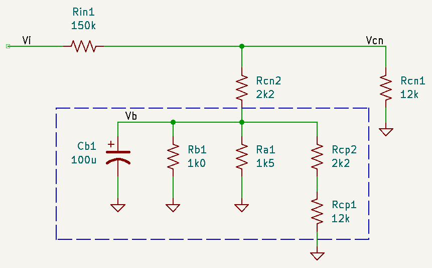
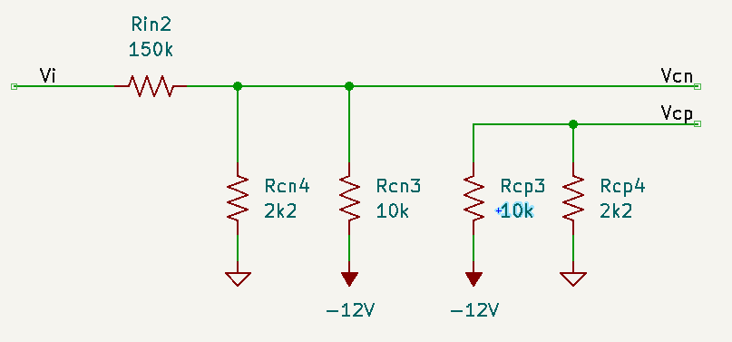
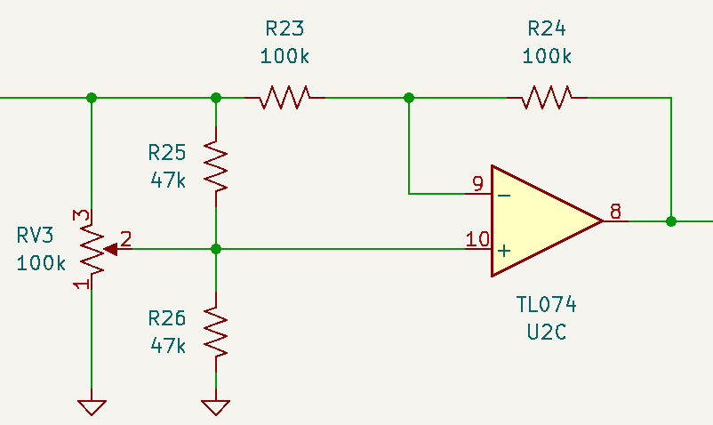
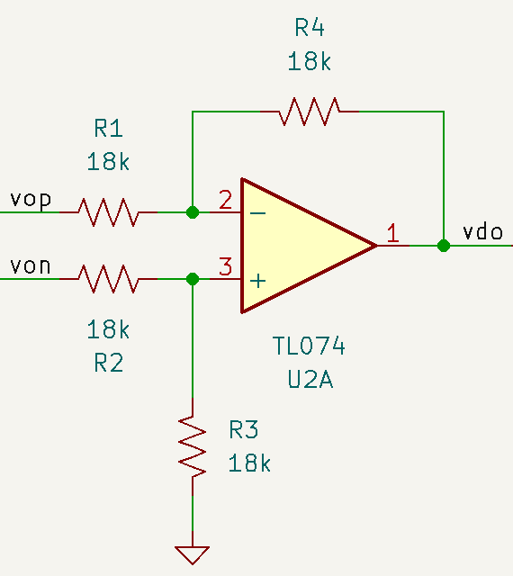

# Design

## Overview

Multipliers have a number of names in electronics, stemming from the fact that there's no natural circuit element that implements $A \times B$ (it's non-linear, but the main non-linear physical processes obtained from active components like diodes and transistors are exponential). There are many articles on the topic for music synthesis, which mainly boil down to 

* approximating $A \times B$ by constraining $A \geq 0$, referred to as a two-quadrant multiplier. This is a VCA.
* following the path established for radio using a small signal approach with non-linear devices: diode mixers and  balanced modulators.

The multiplier processes two time-varying signals that encode some frequency content (e.g. audio). Musically, multipliers are interesting because of how the time domain operation (multiplication) transforms in the frequency domain: [convolution](https://en.wikipedia.org/wiki/Convolution). A periodic signal can contain frequency content that appears as multiples of its fundamental frequency (overtones). Two or more periodic signals can be summed, but the result will only contain the same frequency content as in its components. Convolution will generate new frequency content adjacent to the spectra of the source signals.

## Diode Mixers

Diode-based [mixers](https://en.wikipedia.org/wiki/Frequency_mixer) makes use of the Taylor series expansion of the exponential: $\exp(x) = 1 + x + \frac{1}{2}x^2 + \cdots$. Let $A\equiv e^a $ and $B\equiv e^b$, such that $AB = e^a e^b = e^{a+b}$, 

$$\begin{align*}
\exp(a+b) &= 1 + (a+b) + \frac{1}{2}(a+b)^2 + \cdots \\
          &= 1 + a + b + \frac{a^2}{2} + ab + \frac{b^2}{2} + \cdots \\
\end{align*}$$

which has the product $ab$. The $a$ and $b$ terms can be subtracted, and the higher order terms ($O(x^3)$ and higher)  are assumed to be negligible in amplitude. 

It's easier to see what happens if $a$ and $b$ are sinusoids:

$$\begin{align*}
a &= \cos \alpha \\
b &= \cos \beta \\
\end{align*}$$

Using the trig identities 

$$\begin{align*}
\sin(\alpha \pm \beta) &= \sin\alpha\cos\beta \pm \cos\alpha\sin\beta \\
\cos(\alpha \pm \beta) &= \cos\alpha\cos\beta \mp \sin\alpha\sin\beta \\
\end{align*}$$

We get

$$\begin{align*}
ab &= \cos\alpha\cos\beta \\
    &= \frac{1}{2}\left[\cos(\alpha + \beta) + \cos(\alpha - \beta)\right] \\
a^2 &= \cos^2\alpha \\
    &= \frac{1}{2}\left( 1 + \cos 2\alpha \right)  
\end{align*}$$

and similarly for $b^2$. Typically for radio, frequency $\beta \ll \alpha$, which means that $\alpha \pm \beta$ is separate from $2\alpha$ (and $2\beta$) in frequency. By filtering around the carrier frequency ($\alpha$), the $ab$ term is isolated. For an audio application, $\alpha$ and $\beta$ are not necessarily widely separated in frequency: filtering to isolate a product becomes challenging (maybe the mixture adds a distinct *character*?). That leads to Gilbert multipliers.

## Gilbert Multipler Cell

The Gilbert cell extends the idea that the differential current in a long-tailed pair can be controlled by both the input base current and the (shared) emitter current (this is nicely detailed in [MT-079](https://www.analog.com/media/en/training-seminars/tutorials/MT-079.pdf) from Analog Devices, but the derivation that follows comes from Gray and Meyer).

{ width="640" }

Starting with Ebers-Moll ($V_{be} \gg V_T$), assuming negligible base current into Q1A, matched devices ($I_{sa}=I_{sb}$), and applying KVL 

$$\begin{align*}
0 &= V_x - V_{be,1} + V_{be,2}\\
I_c &=  I_s \exp(V_{be}/V_T) \to V_{be} = V_T \ln \frac{I_c}{I_s} \\
\to 0 &= V_x - V_T \ln \frac{I_{c1}}{I_s} + V_T \ln \frac{I_{c2}}{I_s} \\
&= V_x - V_T \ln \frac{I_{c1}}{I_{c2}} \\
\to I_{c2} &= I_{c1}\exp\left(-\frac{V_x}{V_T} \right)
\end{align*}$$

Neglecting base current is equivalent to assuming $\alpha_F=1$, and KCL at the emitter gives

$$\begin{align*}
I_{EE} &= -\frac{V_{be}+V_y}{R_E} = I_{c1} + I_{c2} = I_{c2}\left(1 + \exp\left(\frac{V_x}{V_T} \right)\right) \\
\to I_{c1} &= \frac{I_{EE}}{1 + \exp(- V_x / V_T)} \\
\to I_{c2} &= \frac{I_{EE}}{1 + \exp(  V_x / V_T)} \\
\to I_{c1} - I_{c2} &= I_{EE}\left[\frac{1}{1 + \exp(-V_x / V_T)}  - \frac{1}{1 + \exp(V_x / V_T)}\right] \\
 &= -\frac{V_{be}+V_y}{R_E}\tanh\left(\frac{V_x}{2V_T}\right)
\end{align*}$$

For $V_x / 2V_T \ll 1$, 

$$\begin{align*}
\to I_{c1} - I_{c2} &\simeq -\frac{1}{2V_T}\frac{V_{be}+V_y}{R_E}\frac{V_x R_2}{R_1 + R_2}
\end{align*}$$

which contains the product $V_x V_y$. As the MT-079 app. note points out, this topology is limited by temperature dependence ($V_T = kT/q$), non-linear dependence on $V_{be}$, and the small-signal constraint. 

Barrie Gilbert extended the idea to cross-couple long-tailed pairs. The schematic below illustrates the configuration.

{ width="640" }

The relationship between collector current and differetial voltage established above is the starting point. For Q3-Q6 driven by $V_x$,

$$\begin{align*}
I_{c3} &= \frac{I_{c1}}{1 + \exp(- V_x / V_T)} \\
I_{c4} &= \frac{I_{c1}}{1 + \exp(  V_x / V_T)} \\
I_{c5} &= \frac{I_{c2}}{1 + \exp(  V_x / V_T)} \\
I_{c6} &= \frac{I_{c2}}{1 + \exp(- V_x / V_T)} \\
\end{align*}$$

and for Q1 and Q2 driven by $V_y$, 

$$\begin{align*}
I_{c1} &= \frac{I_{EE}}{1 + \exp(- V_y / V_T)} \\
I_{c2} &= \frac{I_{EE}}{1 + \exp(  V_y / V_T)} \\
\end{align*}$$

Combining these expressions, 

$$\begin{align*}
I_{c3} &= \frac{I_{EE}}{\left[1 + \exp(- V_x / V_T)\right]\left[1 + \exp(- V_y / V_T)\right]} \\
I_{c4} &= \frac{I_{EE}}{\left[1 + \exp(  V_x / V_T)\right]\left[1 + \exp(- V_y / V_T)\right]} \\
I_{c5} &= \frac{I_{EE}}{\left[1 + \exp(  V_x / V_T)\right]\left[1 + \exp(  V_y / V_T)\right]} \\
I_{c6} &= \frac{I_{EE}}{\left[1 + \exp(- V_x / V_T)\right]\left[1 + \exp(  V_y / V_T)\right]} \\
\end{align*}$$

and the resulting differential current $\Delta I = I_{c3,5} - I_{c4,6}$ is

$$\begin{align*}
\Delta I &= I_{EE} \tanh\left(\frac{V_x}{2V_T}\right)\tanh\left(\frac{V_y}{2V_T}\right)
\end{align*}$$

Depending on the amplitude of the signals $V_x$ and $V_y$, the circuit can operate in one of three modes. 

**Analog Multiplier**

Both $V_x \ll V_T$ and $V_y \ll V_T$. All transistors operate in a linear regime. Since $\tanh x \sim x$ for $x \ll 1$, 

$$\Delta I \sim I_{EE}\left(\frac{V_x}{2V_T}\right)\left(\frac{V_y}{2V_T}\right)$$

If more range is desired for one of the input signals, it can be assigned to $V_y$, and emitter degeneration can be used (add resistance at the emitters of the lower differential pair). This increases the range for $V_y$ in the linear regime to approximately $\frac{1}{2} I_{EE} R_E$. This approach only works for the lower differential pair. 

Alternatively, a pre-distortion circuit that implements $\tanh^{-1}x$ can be used. This can be constructed from two diode-connected BJTs, but requires a linear differential voltage to current conversion (see Gray & Meyer 10.3). 

**Balanced Modulator**

If one of the inputs has a large amplitude, the transistors function like switches, in effect multiplying the other (small-signal) input by a square wave alternating between $+1$ and $-1$ ($\tanh x \to \mathrm{sgn}x$). The Fourier series for that square wave is 

$$
V_c(t) = \sum_{n=1}^\infty A_n \cos n\omega_c t   
$$

with $A_n = \mathrm{sinc}(n\pi/2)$. For a sinusoidal modulating signal $V_m(t)$, the output is then proportional to 

$$
V_o \propto \sum_{n=1}^\infty A_n V_m \cos \omega_m t \cos n\omega_c t = \frac{1}{2}\sum_{n=1}^\infty A_n V_m \left[\cos(n\omega_c + \omega_m)t + \cos(n\omega_c - \omega_m)t\right]
$$

equivalent to amplitude modulation with a supressed carrier (the carrier can be re-introduced by adding a DC offset to the modulating signal).

**Phase Detector**

If both inputs are driven with large amplitude, the output becomes the product of two $\mathrm{sgn}x$ functions: positive if they are in phase, negative if not. For two inputs at the same frequency, the average voltage would be proportional to 

$$
V_{avg} \propto \left(\frac{2\phi}{\pi} - 1\right)
$$

Commonly, that signal can be used to construct a phase-locked loop. 

## MC1496

The key references for this section are 

* the datasheet
* AN531-D
* The Yusynth ring modulator

**Note**: schematic images may not match the actual schematic as values and references changed a bit as I refined the design, but the general idea is there.

### DC Biasing

The DC bias in the two branches is set by the current into pin 5, which passes through a "diode" (presumably a diode-connected NPN matched to the bias transistors acting as the current sink) and a series $500\Omega$ resistance. The current in this path (assuming negligible base currents) is given in the datasheet:

$$
    R_5 = \frac{|V_{14}| - V_{d}}{I_5} - 500
$$

where $V_{14}$ is connected to the $V_{EE} = -12V$ rail, $V{d} \simeq 0.75V$ is the diode drop, and $R_5$ is connected to ground. The recommended $I_5=1\mathrm{mA}$ is obtained for approximately $R_5 = 10k\Omega$. The Yusynth design uses $R_5 = 6.8k\Omega$ with a -15V rail for a bias current of $I_5 = 2mA$. The same bias current can be selected with a $R_5 = 4.7k\Omega$ for the -12V rail, which I'll use in this implementation. Consequently, 

$$\begin{align*}
    I_6 &= I_{12} = I_5 = 2\mathrm{mA} \\
    \to I_{14} &= 3I_5 = 6\mathrm{mA}
\end{align*}$$

Next, the DC levels for the input and output pins is set. Starting with the output pins (6 and 12), which sink $I_6=I_{12}=I_5$. KCL at 6 then gives

$$\begin{align*}
    \frac{12 - V_{6}}{R_L} &= I_5 + \frac{V_6}{R_A} \\
    \to V_6 &= \left(\frac{12}{R_L} - I_5\right)\left(\frac{1}{R_L} + \frac{1}{R_A}\right)^{-1}
\end{align*}$$

where $R_A$ is the input impedance to the differential amplifier (30k for the Yusynth design). In the reference design from the app. note, $R_L = 3.9k\Omega$ with $I_5 = 1\mathrm{mA}$, such that $V_6 = V_{12} \simeq 12-4 = 8V$. In the Yusynth design, $V_6=V_{12}\simeq 12V$ (3V below the 15V rail).

Setting $V_6 = V_{12} = 8V$ and $R_L = 1.8k\Omega$, 

$$\begin{align*}
    \frac{12 - V_{6}}{R_L} &= I_5 + \frac{V_6}{R_A} \\
    \to R_A &= V_6 \left(\frac{4}{1800} - 0.002\right)^{-1} = 36k\Omega
\end{align*}$$

which is divided by 2 to get a pair of $18k\Omega$ resistors.

Next, the upper differential pairs are biased to be at least 2V below the outputs ($\sim 6V$). The biasing scheme from the [app note](https://www.onsemi.com/pub/collateral/an531-d.pdf) (Fig. 3) is the starting point. Redrawing the Yusynth design (neglecting the offset correction), calculate the DC operating point (input grounded) and the input impedance. 

{ width="640" }

Assuming negligible current into the base, the biasing voltage divider ($R_a$ and $R_b$) sets $V_b = 5.3V$, including current contributions from the n and p branches despite the divider's low impedance. Consequently, $V_{cn}$ and $V_{cp}$ sit around 6.3V (these numbers from from a DC operating point analysis with SPICE). 

The DC input impedance is dominated by $R_{in}=150k\Omega$. Grounding $V_{CC}$ and applying a 1V bias at $V_{in}$, a simulation shows a current of 6.57uA, such that $R_{in,total}=152.2k\Omega$ and the net resistance at $V_{cn}$ is $2.2k\Omega$. However, the large C effectively shorts the parallel R network for frequencies above 10Hz, so the input impedance network can be simplified. Effectively, it is a voltage divider composed of a 150k resistor in series with $R_{cn} = R_{cn1} \parallel R_{cn2} \simeq 1.8k\Omega$, so the input voltage is scaled by a gain of $A_{c,in} \simeq 0.012$ and e.g. an 8V signal is scaled to 10mV, matching the Yusynth design

{ width="640" }

A SPICE netlist to check the values is listed here. Set the DC voltaged applied at V2=1 and set V1=0 to check the DC input impedance.

```spice
.title KiCad schematic
Cb1 /Vb 0 100u
Rcn2 /Vb /Vcn 2.2k
Rcp2 /Vb /Vcp 2.2k
Rcp1 VCC /Vcp 12k
Rb1 0 /Vb 1.0k
Rcn1 VCC /Vcn 12k
Ra1 /Vb VCC 1.5k
Rin1 /Vi /Vcn 150k
V1 VCC 0 12
V2 /Vi 0 DC 0 AC 1
.control
    op
    print v(/Vb) v(/Vcp) v(/Vcn)
*   print -1/i(V2)  
    ac dec 50 10 100k
    let zin = -1/i(V2)
    let zmag = mag(zin)
    let zph = 180/pi*ph(zin)
    plot zmag vs frequency xlog xlabel '|Zin| (ohm)'
.endc
.end
```

**Notes**

* Ra1=2.2k lowers Vcn to $\sim4.5V$
* Rcp1=10k and Rcn1=10k matches the lower branch and sets Vcn, Vcp around 5.8V
* Varying $V_i$ (`V2` in the netlist) from -10V to 10V changes $V_b$ by approximately 70mV, but the transfer function stays linear (assuming that the base current change is negligible)


The lower differential pair follows a similar analysis: the objective is to match the input impedance and gain by combining a voltage divider to bias the input with a parallel combination equivalent to $R=1.8k\Omega$. Choosing one of the $R'_{cn} = R'_{cp} = 2.2k\Omega$ as before, the other resistor in the divider is $10k\Omega$ such that $R_{cn} = R_{cp} = 2.2k\Omega \parallel 10k\Omega \simeq 1.8k\Omega$. 

{ width="640" }

### Voltage Gain

From the datasheet, the small-signal DC gain is defined relative to a "carrier" amplitude $V_C < 25mV$ (for linear operation). 

$$
A = \frac{R_L V_C}{2(R_E + 2r_e)V_{th}}
$$

where

* $R_L = 1.8k\Omega \parallel 36k\Omega \simeq 1.8k$
* $V_C \simeq 0.0118 v_{ia} $
* $R_E=0$ (external emitter degeneracy resistance across pins 2 & 3)
* $r_e = \frac{26mV}{I_5} = 13\Omega$
* $V_{th} = \frac{kT}{q} = 0.026V$

such that $v_{do} = 2\times 0.0157 v_{ia}v_{ib} = 0.0314v_{ia}v_{ib}$ with the factor of 2 applied for the differential output voltage.


## OpAmps

### Attenuverter

A nice write-up from [Kassutronics](https://kassu2000.blogspot.com/2018/04/precision-attenuverter-mixer.html) explains this well and describes a technique to create a quasi-logarthimic response with a wider "near-zero" region. 

{ width="640" }

Analyzing the circuit assuming an ideal opamp ($v_n = v_p$), note that the fixed resistances across the tap and ends of the pot act in parallel to the arms of the pot, which affects the voltage divider to $v_p$:

$$\begin{align*}
\mathrm{let}\ R_a &= R'_{V3} \parallel R_{25}\\
\mathrm{let}\ R_b &= R''_{V3} \parallel R_{26}\\
\to v_p &= v_i \frac{R_b}{R_a + R_b}
\end{align*}$$

KCL at $v_n$ then gives

$$\begin{align*}
\frac{v_i - v_n}{R_{23}} + \frac{v_o - v_n}{R_{24}} &= 0 \quad\mathrm{with}\ R = R_{23} = R_{24} \\
\to v_o &= 2v_n - v_i
\end{align*}$$

In the linear attenuverter, $v_n = v_p = \alpha v_i$ (some ratio of $v_i$ given by a division ratio set by the pot). With the additional resistors in parallel, $\alpha$ is not linear, but still ranges between 0 and 1. 

### Differential Amplifier

Analyzing the differential amplifier (again assuming an ideal opamp), noting that $R_1 = R_2 = R_3 = R_4 \equiv R$

$$\begin{align*}
v_p &= \frac{v_{on}}{2} \\
\frac{v_{op} -v_n }{R} &= \frac{v_n - v_{do}}{R} \\
\to v_{do} &= 2v_n - v_{op} = v_{on} - v_{op} \\
&= -\left(v_{op}-v_{on}\right)
\end{align*}$$

It is in an inverting configuration, which is consistent with the inputs to the multiplier being applied at the inverting inptus of each differential pair.

{ width="640" }

### Inverting Summing Amplifier

The DC gain through the multipler (including input attenuation) and differential amplifier is approximately (see the DC gain section above)

$$
A_d = 0.0314v_{ia}v_{ib}
$$

In the [Yusynth design](https://yusynth.net/Modular/EN/RINGMOD/index.html), a make up gain of 6.8 is applied after the differential amplifier: $v_{o}= 6.8v_{do} = 0.214v_{ia}v_{ib}$. Consequently, the output amplitude and input amplitudes match ($v_o = v_{ia} = v_{ib}$) approximately when $|v|=5V$ (two input signals with $V_{pk} = 5V$ results in an output signal with the same $V_{pk}$, and the output will clip around $|v_i|\gtrapprox 6.8V$).

The relationship for an inverting summing amplifier is

$$\begin{align*}
v_o &= -R_f \left(\frac{v_1}{R_1} + \frac{v_2}{R_2} + \cdots\right) \\
 &= -v_1 \frac{R_f}{R_1} - v_2 \frac{R_f}{R_2} - \cdots 
\end{align*}$$

Choosing $R_f = 68k\Omega$ and $R_1=10k\Omega$ (per the Yusynth design), $R_2=68k\Omega$ is selected such that the input from the (attenuverted) sum input is added with unity gain.

## Transfer Function

Overall, the output should be

$$\begin{align*}
v_o &= -6.8v_{do} - \alpha_c v_c \\
    &= -6.8(-0.0314 v_a \alpha_b v_b) - \alpha_c v_c \\
    &= 0.214 v_a (\alpha_b v_b) + (- \alpha_c) v_c
\end{align*}$$

where $-1 \leq \alpha_b, \alpha_c \leq +1$ are the attenuverter coefficients. Note that the polarity of the sum input should be inverted at the attenuverter for $A\times B + C$.

## References

1. MC1496 Datasheet, [onsemi.com](https://www.onsemi.com/pdf/datasheet/mc1496-d.pdf)
2. Yves Usson, "Dual balanced modulator (ring modulator)," [yusynth.net](https://yusynth.net/Modular/EN/RINGMOD/index.html)
3. A*B+C module, [befaco.org](https://www.befaco.org/abc/)
4. Paul Gray and Robert Meyer, *Analysis and Design of Analog Integrated Circuits*, 4th ed. Wiley, New York (2001)
5. "Analog Multipliers" Analog Devices app. note MT-079 [analog.com](https://www.analog.com/media/en/training-seminars/tutorials/MT-079.pdf)
6. "MC1496 Balanced Modulator" Onsemi app. note AN531-D [onsemi.com](https://www.onsemi.com/pub/collateral/an531-d.pdf)
7. Kassutronics, "Precision Attenuverter/mixer" [kassu2000.blogspot.com](https://kassu2000.blogspot.com/2018/04/precision-attenuverter-mixer.html)